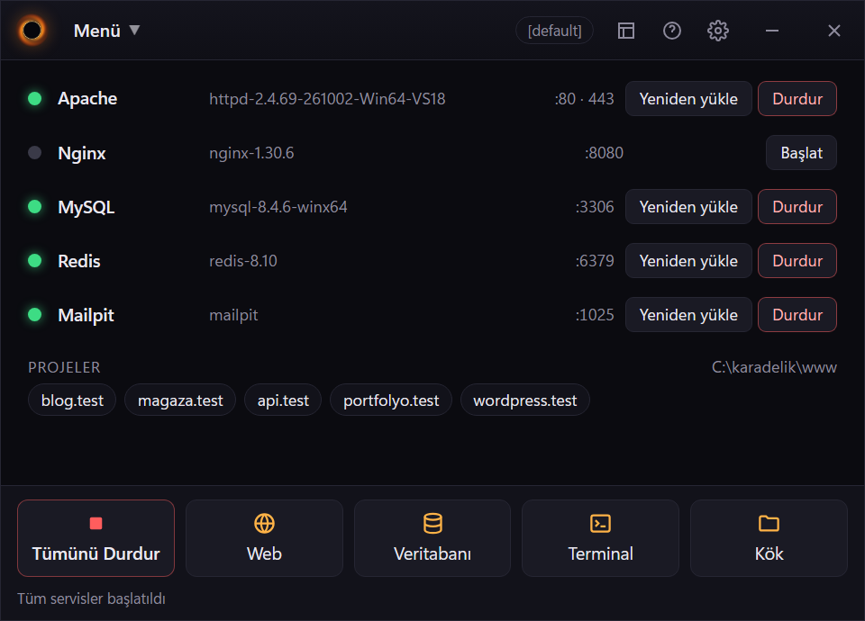
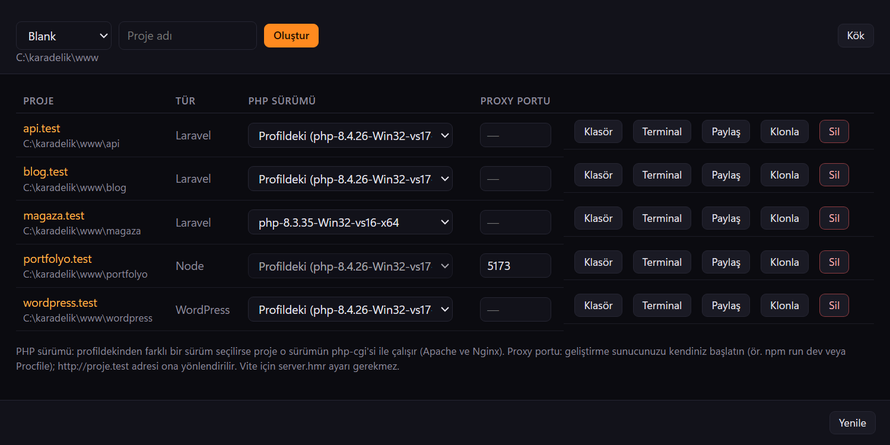
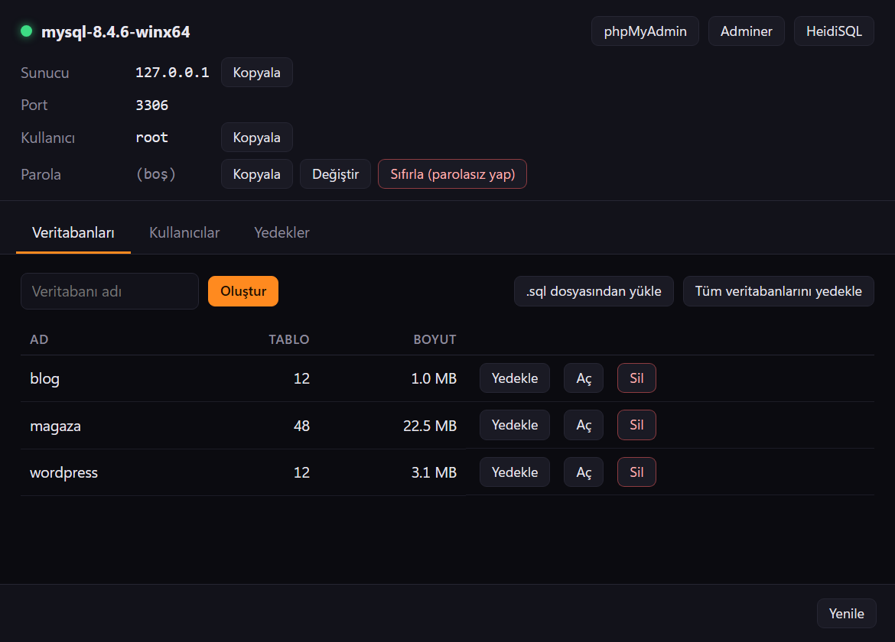
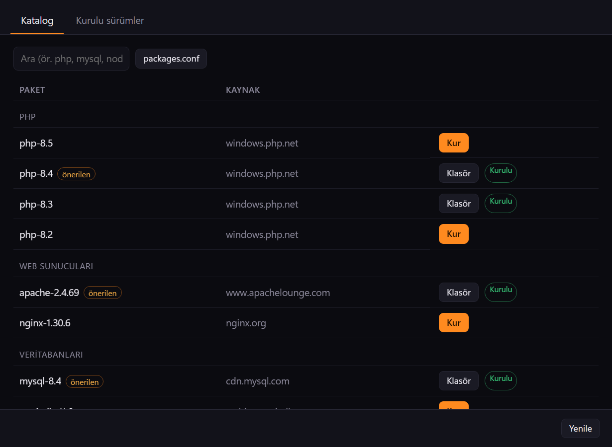
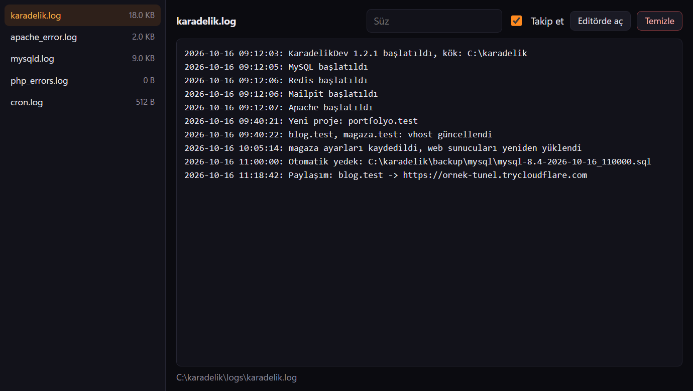
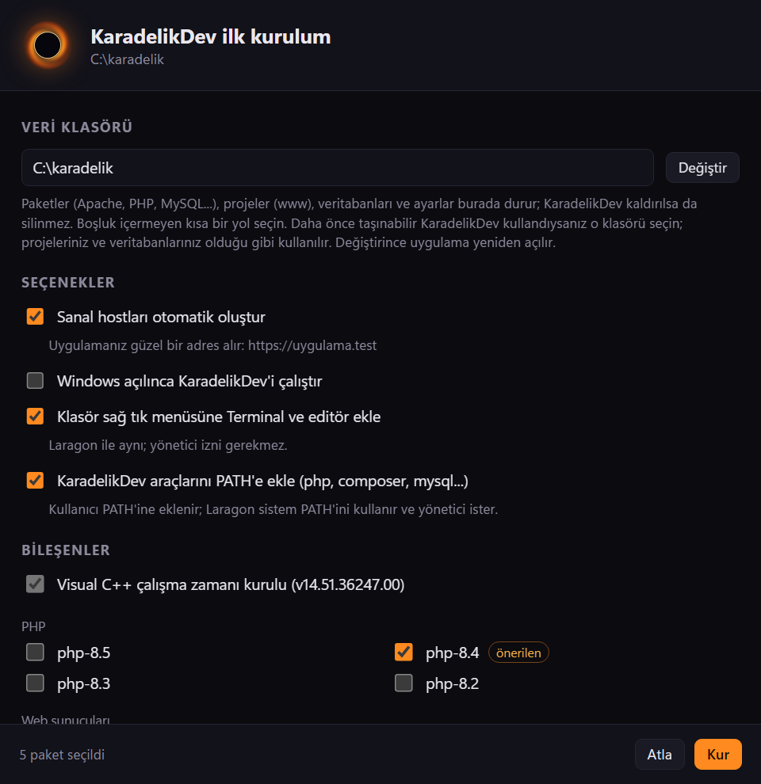
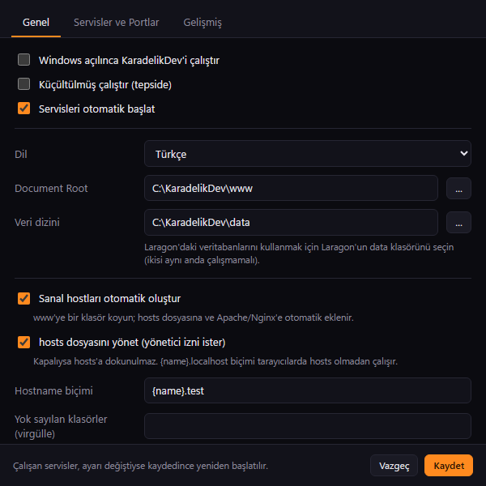

<div align="center">


# KaradelikDev

**Windows ve macOS için hızlı ve hafif yerel geliştirme ortamı.**
Apache, Nginx, PHP, MySQL/MariaDB, PostgreSQL, MongoDB, Redis, Memcached ve Mailpit tek pencereden.
`www` içine bir klasör koyun, `klasor.test` adresi kendiliğinden hazır olsun.

[](https://github.com/enesbsafak/karadelikdev/releases/latest)
[](LICENSE)


<sub>*A local development environment for Windows and macOS (Apache/Nginx, PHP, MySQL/MariaDB, PostgreSQL, MongoDB, Redis, Mailpit) with automatic `*.test` virtual hosts. UI in Turkish and English.*</sub>



</div>

---

## İçindekiler

- [Özellikler](#özellikler)
- [Neden KaradelikDev?](#neden-karadelikdev)
- [Hızlı başlangıç](#hızlı-başlangıç)
- [macOS](#macos)
- [Kullanım](#kullanım)
- [Klasör yapısı](#klasör-yapısı)
- [Yapılandırma](#yapılandırma)
- [Komut satırı](#komut-satırı)
- [Varsayılan portlar](#varsayılan-portlar)
- [Güvenlik notları](#güvenlik-notları)
- [Bilinen sınırlamalar](#bilinen-sınırlamalar)
- [Kaynaktan derleme](#kaynaktan-derleme)
- [Lisans](#lisans)

## Özellikler

**Servisler**
- Apache (mod_php veya php-cgi), Nginx, PHP yerleşik sunucusu
- MySQL ve MariaDB, PostgreSQL, MongoDB, Redis, Memcached, Mailpit
- Her servis için başlat / durdur / yeniden yükle, sürüm seçimi, log ve ayar dosyaları
- Port başka bir uygulamadaysa sahibini gösteren uyarı
- Apache, MySQL ve PostgreSQL için "Windows servisi olarak çalıştır"

**Projeler**
- **Otomatik sanal host:** `www\blog` → `http://blog.test`, alt alan adları dahil (`api.blog.test`)
- Laravel/Symfony `public` klasörünü kendiliğinden algılama
- **Proje başına PHP sürümü:** her proje farklı bir PHP sürümüyle çalışabilir (Apache ve Nginx, php-cgi)
- **Node/Vite proxy:** `http://proje.test` adresini `npm run dev` gibi bir geliştirme sunucusuna yönlendirme, WebSocket/HMR dahil
- **Projeler ekranı:** PHP sürümü, proxy portu, klasör, terminal, paylaşma, klonlama ve silme tek listede
- hosts dosyası yönetimi (değişiklik olduğunda yönetici izni sorar)
- **Hızlı uygulama:** Boş proje, WordPress, Laravel, Symfony, CodeIgniter; veritabanı, `.env` ve `wp-config.php` otomatik
- Projeyi klonlama ve silme (veritabanıyla birlikte)
- Cloudflare Tunnel veya ngrok ile internete paylaşma, QR kod

<p align="center"></p>

**Veritabanı yöneticisi**
- Bağlantı bilgileri tek ekranda, parola değiştirme ve kaldırma
- Veritabanı listesi (tablo sayısı, boyut), oluşturma, silme, phpMyAdmin'de açma
- Yalnız tek bir veritabanına yetkili MySQL kullanıcısı oluşturma
- Tekil ve toplu yedek, `.sql` dosyasından geri yükleme, otomatik yedek (varsayılan 8 saatte bir, son 5)
- Her MySQL/MariaDB sürümü kendi veri klasörünü ve parolasını kullanır

<p align="center"></p>

**PHP**
- Birden çok PHP sürümü, tek tıkla geçiş
- Eklentileri ve hızlı ayarları (xdebug, opcache, memory_limit, upload boyutu…) menüden açıp kapatma
- `mail()` → Mailpit, `cacert.pem` ve php.ini yolları otomatik
- Otomatik güncelleme: yeni PHP yama sürümlerini SHA-256 doğrulamasıyla indirir

**SSL**
- Yerel kök sertifika yetkilisi (CA) ve her proje için sertifika; OpenSSL gerekmez
- CA bir kez kullanıcı deposuna eklenir (yönetici izni gerekmez), `https://proje.test` uyarısız açılır

**Araçlar**
- **İlk kurulum sihirbazı:** Visual C++ çalışma zamanı denetimi, önerilen paketler, PATH, sağ tık menüsü
- **Hızlı ekle / Paketler ekranı:** `packages.conf` listesinden indir ve kur (zip, tar.gz, tar.xz), kurulu sürümler arasında geçiş
- **Loglar ekranı:** tüm logları canlı izleme, süzme ve temizleme
- **Uygulama içi güncelleme:** yeni sürümü SHA-256 doğrulamasıyla indirir, servisleri yeniden başlatır; tek tıkla önceki sürüme dönüş
- **Laragon'dan içe aktar:** mevcut Laragon kurulumunun binary'lerini kopyalamadan kullanır
- Windows Terminal / cmd / PowerShell / Cmder; tüm sürümler PATH'te hazır (`Ctrl+Alt+T`)
- Procfile (arka plan komutları), yerleşik cron, profiller, PATH ve Explorer sağ tık menüsü

<p align="center">


</p>
- Türkçe ve İngilizce arayüz

## Neden KaradelikDev?

KaradelikDev, Laragon'un sevilen çalışma modelini (taşınabilir klasör, `*.test` adresler, tek tıkla servisler) örnek alır ve bazı noktalarda daha ileri gider:

| | KaradelikDev |
|---|---|
| Binary klasörleri | `bin\` içindeki dosyalara hiç yazılmaz; tüm ayarlar `etc\` altında üretilir. Sürüm güncellemek ayarları bozmaz, aynı binary'ler başka araçlarla paylaşılabilir. |
| Sürüm başına veritabanı parolası | MySQL 8.4, 9.4 ve MariaDB'nin her biri kendi parolasını tutar; sürüm değişince "Access denied" olmaz. |
| Veritabanı yöneticisi | Kullanıcı ve yetki yönetimi, tekil yedek, geri yükleme ekranı. |
| SSL | Yerel CA + host başına sertifika, yönetici izni olmadan güvenilir. |
| Paylaşım | Hesap gerektirmeyen Cloudflare Tunnel desteği. |
| Kurulum | Yeni bir paket indirmek aktif sürümü değiştirmez; sürüm değişiminde servisler eski ayarla temiz kapatılır. |
| Otomasyon | `karadelikdev do <eylem>` ve pencere açmadan çalışan `--headless` / `--setup` modları. |

> KaradelikDev bağımsız bir projedir; Laragon ile bağlantısı yoktur. "Laragon" adı sahibine aittir ve burada yalnızca karşılaştırma ve içe aktarma özelliği için anılır.

## Hızlı başlangıç

1. [Son sürümden](https://github.com/enesbsafak/karadelikdev/releases/latest) `KaradelikDev-<sürüm>-setup.exe`'yi indirip çalıştırın. Program `C:\Program Files\KaradelikDev`'e kurulur (yönetici izni ister, UAC'a **Evet**); Başlat menüsüne ve masaüstüne kısayol ekler.
2. KaradelikDev ilk açılışta **kurulum sihirbazını** gösterir:
   - **Veri klasörü:** paketler, projeler ve veritabanları buraya gider (varsayılan `C:\karadelik`, boşluksuz bir yol seçin). Daha önce taşınabilir KaradelikDev kullandıysanız o klasörü seçin.
   - Bilgisayarda Laragon varsa "Laragon'dan içe aktar" seçilidir (indirme yapılmaz).
   - Yoksa önerilen paketler seçilidir: Apache, PHP 8.4, MySQL 8.4, phpMyAdmin, Composer, Mailpit.
3. **Kur** → **Bitir** → **Tümünü Başlat**.
4. `C:\karadelik\www\merhaba\index.php` oluşturun ve `http://merhaba.test` adresini açın.

**Kaldırma:** Ayarlar → Uygulamalar → KaradelikDev → Kaldır. Servisler durdurulur; otomatik başlatma, sağ tık menüsü ve PATH girdileri silinir. Veri klasörü (projeler, veritabanları) **silinmez**; isterseniz elle silin. hosts dosyasındaki `.test` girdileri ve yerel SSL kök sertifikası kalır (Menü → Araçlar → SSL'den kaldırmadan önce güveni kaldırabilirsiniz).

> **Gereksinimler:** Windows 10/11 x64, Microsoft Edge WebView2 (Windows 11'de hazır). Sihirbaz eksikse Visual C++ çalışma zamanını kurmayı önerir.
>
> Kurulum programı şimdilik dijital olarak imzalı değil; Windows SmartScreen "Bilinmeyen yayımcı" uyarısı gösterebilir: **Ek bilgi → Yine de çalıştır**.

<details>
<summary><b>Kurulum sihirbazı ve Tercihler</b></summary>
<p align="center">


</p>
</details>

## macOS

macOS sürümü Windows'taki özelliklerin tamamını aynı arayüzle sunar; yalnız binary'ler Homebrew'dan gelir.

1. [Son sürümden](https://github.com/enesbsafak/karadelikdev/releases/latest) Mac'inize uygun `KaradelikDev-<sürüm>-macos-aarch64.dmg` (Apple Silicon) veya `-macos-x86_64.dmg` (Intel) dosyasını indirin, KaradelikDev'i **Uygulamalar** klasörüne sürükleyin.
2. Uygulama şimdilik Apple Developer ID ile imzalı değil (ad-hoc imza). İlk açılışta "doğrulanamadı" uyarısı çıkarsa: Finder'da KaradelikDev'e **sağ tık → Aç → Aç** (veya Sistem Ayarları → Gizlilik ve Güvenlik → **Yine de Aç**).
3. Kurulum sihirbazı açılır. **Homebrew** yoksa "Homebrew'u kur" seçeneği resmi kurulum betiğini Terminal'de açar (parola ister); bitince **Yeniden denetle**. Önerilen paketler: Apache, PHP 8.4, MySQL 8.4, phpMyAdmin, Composer, Mailpit. Homebrew'da zaten kurulu olan paketler (ör. `mariadb`, `nginx`) indirme yapılmadan bağlanır.
4. **Kur** → **Bitir** → **Tümünü Başlat**; `~/KaradelikDev/www/merhaba/index.php` oluşturun, `http://merhaba.test` açılır.

**Nasıl çalışır?**
- Paketler `brew install` ile kurulur; `bin/<kategori>/<ad>-<x.y>` Homebrew'un `opt/<formül>` klasörüne sembolik bağlantıdır (ör. `bin/php/php-8.4 -> /opt/homebrew/opt/php@8.4`). Servisler `brew services` ile **değil**, KaradelikDev'in `etc/` altında ürettiği ayarlarla çalışır; Homebrew'un kendi ayar dosyalarına dokunulmaz. Aynı anda `brew services` ile çalışan bir MySQL/PostgreSQL varsa portu Tercihler'den değiştirin (Unix soketleri ayrı olduğu için çakışmazlar).
- Apache'de PHP, Homebrew PHP'nin `libphp.so` modülüyle (mod_php) çalışır; Nginx ve proje başına PHP sürümleri php-cgi havuzunu kullanır. PHP yama güncellemeleri `brew upgrade` ile gelir (Menü → PHP → Güncellemeleri denetle).
- macOS, root olmayan uygulamaların 80/443 portlarını yalnız **tüm arabirimlerde** dinlemesine izin verir (`127.0.0.1:80` reddedilir). KaradelikDev bu portları tüm arabirimlerde dinler ve "Yerel ağdan erişime izin ver" kapalıyken istekleri sunucunun içinde bu Mac ile sınırlar (Apache `Require local`, Nginx `allow 127.0.0.1`). macOS güvenlik duvarı açıksa ilk başlatmada `httpd` için bir izin sorusu görebilirsiniz.
- `.test` adresleri için `/etc/hosts` güncellenirken macOS yönetici parolasını sorar; ardından DNS önbelleği temizlenir. Yerel SSL kök sertifikası giriş anahtar zincirine eklenir (macOS güven ayarı için parolanızı sorar).

| Windows | macOS |
|---|---|
| Tepsi simgesi, sol tık pencere | Menü çubuğu simgesi (tıklayınca menü); ayrıca uygulama menüsü, Düzen ve Pencere menüleri, Dock |
| `Ctrl+Alt+T` terminal | `⌥⌘T`; Terminal.app veya iTerm2 (Tercihler → Gelişmiş). Kabuğunuz kendi ayarlarını okur, sonra `usr/kdenv.sh` yüklenir |
| Explorer sağ tık menüsü | Finder Hızlı Eylemleri: klasöre sağ tık → Hızlı Eylemler → KaradelikDev Terminal / Editör |
| Kullanıcı PATH'i (kayıt defteri) | `~/.zprofile` (bash kullanıyorsanız `~/.bash_profile`) içinde işaretli blok |
| Windows servisi olarak çalıştır | Oturum açılınca servis olarak çalıştır: `~/Library/LaunchAgents/dev.karadelik.<servis>.plist` (yönetici izni gerekmez) |
| Windows açılınca çalıştır | Oturum açılınca çalıştır (LaunchAgent) |
| HeidiSQL | Sequel Ace / TablePlus / DBeaver (kuruluysa; bağlantı bilgisiyle açılır), phpMyAdmin, Adminer |
| `usr\user.cmd` | `usr/user.sh` |
| Laragon'dan içe aktar | — (Windows'a özgü) |

**Güncelleme (macOS).** Menü → KaradelikDev → Güncelle: `.app.tar.gz` indirilir, SHA-256 ile doğrulanır, uygulama kapanınca `/Applications/KaradelikDev.app` yenisiyle değiştirilip açılır ve çalışan servisler yeniden başlatılır.

**Kaldırma (macOS).** İsterseniz önce `/Applications/KaradelikDev.app/Contents/MacOS/karadelikdev --uninstall` çalıştırın (servisleri durdurur; oturum açılışı, Hızlı Eylemler, PATH bloğu ve LaunchAgent'lar silinir), sonra uygulamayı Çöp Sepeti'ne sürükleyin. `~/KaradelikDev` (projeler, veritabanları) ve Homebrew paketleri silinmez.

## Kullanım

| Nerede | Ne yapar |
|---|---|
| **Menü** (sol üst), pencereye sağ tık, tepsi ikonuna sağ tık | Tüm özelliklerin bulunduğu menü |
| **Tümünü Başlat / Durdur** | Tercihler'de etkin servisleri başlatır / durdurur |
| **Web** · **Veritabanı** · **Terminal** · **Kök** | `localhost`'u açar · Veritabanı yöneticisi · KaradelikDev terminali · `www` klasörü |
| Projeler satırı | Projeye tıklayınca adresini tarayıcıda açar |
| Pencereyi kapatmak | Tepsiye küçültür; çıkış için Menü → Çıkış (servisleri durdurur) |

**Otomatik sanal host.** `www` altındaki her geçerli klasör (harf, rakam, `-`) bir adres olur. Hostname biçimi Tercihler'den değiştirilebilir (ör. `{name}.localhost`; bu biçim hosts dosyasına gerek duymaz). Bir vhost dosyasını kendiniz yönetmek isterseniz adındaki `auto.` önekini kaldırın; KaradelikDev o dosyaya dokunmaz.

**Hızlı uygulama.** Menü → Hızlı uygulama → şablon → proje adı. URL şablonları (WordPress) indirilip açılır; komut şablonları (Laravel, Symfony) terminalde çalışır ve bitince `.env` ile veritabanı ayarlanır. Şablonlar `usr\sites.conf`'ta.

**Paylaşım.** Menü → Paylaş → proje. Varsayılan Cloudflare Quick Tunnel'dır (hesap gerekmez); ngrok da seçilebilir. Bağlantı panoya kopyalanır ve QR kodla gösterilir.

**Procfile ve cron.** `usr\Procfile` içindeki komutlar (`Vite: npm run dev pwd=www/proje`) menüden ya da `autorun` ile açılışta çalışır. `usr\crontab` standart 5 alanlı cron biçimini kullanır; çıktı `logs\cron.log`'a yazılır.

**Profiller.** Seçili sürümler (PHP, MySQL, Apache…) profil olarak saklanır; Menü → Profil ile geçiş yapılır.

**Proje başına PHP sürümü.** Ana pencerede Projeler → Yönet (veya Menü → KaradelikDev → Projeler) ekranında bir projeye profildekinden farklı bir PHP sürümü seçin. O sürümün `php-cgi.exe`'si 9101'den başlayan portlarda ayrıca çalıştırılır; diğer projeler profildeki sürümle devam eder. Ayarlar `usr\projects.ini`'de tutulur.

**Node/Vite proxy.** Aynı ekranda **Proxy portu** alanına geliştirme sunucusunun portunu (ör. Vite için `5173`) yazın. `http://proje.test` o porta yönlendirilir; WebSocket (HMR) de geçer. Sunucuyu kendiniz başlatın (terminal veya Procfile: `Vite: npm run dev pwd=www/proje`).

**Güncelleme.** KaradelikDev açılışta ve günde bir yeni sürüm olup olmadığına bakar (Tercihler → Gelişmiş'ten kapatılabilir). Menü → KaradelikDev → Güncelle: kurulum programı indirilir, SHA-256 ile doğrulanır, uygulama kapanır, kurulum yapılır (yalnız UAC onayı istenir) ve KaradelikDev yeniden açılıp çalışan servisleri tekrar başlatır. **Önceki sürüme dön**, güncellemeden önceki sürümün kurulum programını GitHub'dan indirip (o sürümün `SHA256SUMS.txt`'siyle doğrulayarak) aynı yoldan kurar.

## Klasör yapısı

```
C:\Program Files\KaradelikDev\   program (karadelikdev.exe, uninstall.exe)
/Applications/KaradelikDev.app  macOS: program; veri klasörü ~/KaradelikDev (bin/ altındakiler Homebrew'a bağlantı)

C:\karadelik\                  veri klasörü (sihirbazdan değiştirilebilir)
├─ bin\<kategori>\<sürüm>\   Apache, PHP, MySQL… (Hızlı ekle veya Laragon'dan içe aktar)
├─ etc\                      üretilen ayarlar: apache2, nginx, php\<sürüm>\php.ini, mysql, ssl, apps
├─ data\                     veritabanı dosyaları (sürüm başına: mysql-8.4, mariadb-11.8, postgresql-18.2…)
├─ www\                      Document Root
├─ usr\                      karadelik.ini, packages.conf, sites.conf, Procfile, crontab, profile\, tpl\
├─ logs\  tmp\  backup\
```

## Yapılandırma

| Dosya | İçerik |
|---|---|
| `usr\karadelik.ini` | Tercihler, portlar, servis seçimleri (Tercihler penceresinden düzenlenir) |
| `usr\projects.ini` | Proje başına PHP sürümü ve proxy portu (Projeler ekranından düzenlenir) |
| `usr\profile\<ad>.ini` | Profilin seçili sürümleri |
| `usr\packages.conf` | Hızlı ekle listesi: `ad=URL`; `*` ile başlayanlar ilk kurulumda önerilir |
| `usr\sites.conf` | Hızlı uygulama şablonları: `Ad=URL` veya `Ad=komut %s` |
| `usr\tpl\*.tpl` | Apache/Nginx/MySQL şablonlarını geçersiz kılmak için (Menü → Araçlar → Şablonlar) |
| `usr\user.cmd` | Terminal açılırken çalışan kendi komutlarınız |

## Komut satırı

```bat
karadelikdev reload [apache|nginx]        :: vhost'ları yenile, web sunucularını yeniden yükle
karadelikdev start|stop [servis]          :: ör. karadelikdev start mysql
karadelikdev do <eylem> [değer]           :: menü eylemini çalıştır, ör. do startall · do dbcall:create_db blog
karadelikdev --terminal <klasör>          :: KaradelikDev ortamıyla terminal

:: Pencere açmadan (betikler ve CI için)
karadelikdev --setup [--import-laragon] [--no-vc] [paket,paket…]
karadelikdev --headless start|stop
karadelikdev --headless pg-password <parola>   :: PostgreSQL çalışırken postgres parolası (boş = parolasız)
```

Veri klasörü `HKCU\Software\KaradelikDev\DataRoot` kaydında (macOS: `~/Library/Application Support/KaradelikDev/config.json`) tutulur (sihirbazdan değiştirilir); `KARADELIK_ROOT` ortam değişkeni her ikisinin önüne geçer. macOS'ta `karadelikdev` komutu KaradelikDev terminalinde ve PATH'e eklendiyse her terminalde kullanılabilir (`usr/bin/karadelikdev`). Kurulum dışında, ör. kaynak koddan derlenmiş bir exe, kendi klasörünü kök olarak kullanır.

## Varsayılan portlar

| Servis | Port | Dinlediği adres |
|---|---|---|
| Apache | 80, SSL 443 | 127.0.0.1 ve ::1 (Tercihler'den yerel ağa açılabilir). macOS: tüm arabirimler, erişim bu Mac ile sınırlı |
| Nginx | 8080, SSL 8443 | 127.0.0.1 ve ::1 (Tercihler'den yerel ağa açılabilir) |
| MySQL / MariaDB | 3306 | 127.0.0.1 |
| PostgreSQL | 5432 | localhost |
| MongoDB | 27017 | 127.0.0.1 |
| Redis | 6379 | 127.0.0.1 |
| Memcached | 11211 | 127.0.0.1 |
| Mailpit | SMTP 1025, arayüz 8025 | 127.0.0.1 |
| PHP Server | 8000 | 127.0.0.1 |
| php-cgi havuzu | 9001+ (proje başına sürümler 9101+) | 127.0.0.1 |

## Güvenlik notları

KaradelikDev'in varsayılanları **tek kullanıcılı bir geliştirme bilgisayarı** için kolaylığa göre seçilmiştir:

- MySQL/MariaDB `root` kullanıcısı varsayılan olarak **parolasızdır**; PostgreSQL yerel bağlantılara parola sormaz (`trust`). İkisine de menüden parola konabilir (MySQL → root parolasını değiştir, PostgreSQL → postgres parolasını değiştir); PostgreSQL'de parola konunca yerel bağlantılar `scram-sha-256` ile parola ister.
- Bütün servisler yalnız bu bilgisayarı dinler. Apache/Nginx'i telefonla test için yerel ağa açmak isterseniz: Tercihler → Servisler ve Portlar → **Yerel ağdan erişime izin ver**.
- `.env`, `.git` gibi nokta ile başlayan dosya ve klasörler web sunucusundan sunulmaz (`/.well-known` hariç).
- phpMyAdmin, Adminer gibi yönetim panelleri yalnız bu bilgisayardan ve `localhost` adresiyle açılır; tünelle paylaşılan bir projenin adresi veya DNS rebinding ile erişilemez.
- MySQL'in dosya okuma/yazma komutları (`LOAD DATA INFILE`, `SELECT … INTO OUTFILE`) yalnız `data\mysql-files` klasörüyle sınırlıdır.
- KaradelikDev klasörü başka yerel kullanıcıların yazabileceği bir yerdeyse (ör. `C:\karadelik`, `C:\` izinlerini devralır) açılışta izinleri yalnız sizinle, yöneticilerle ve SYSTEM ile sınırlar.
- Paylaş (tünel) özelliği projeyi internete açar; gizli bilgileri web kökünde tutmayın.
- Üretim ortamı olarak kullanmayın.

## Bilinen sınırlamalar

- Exe imzasız (SmartScreen uyarısı). macOS uygulaması ad-hoc imzalı (ilk açılışta Gatekeeper uyarısı).
- Kök klasör yolunda boşluk olmamalı (Apache ve MySQL ile uyumluluk).
- KaradelikDev ve Laragon aynı portları kullanır; ikisini aynı anda çalıştırmayın.
- Laragon'dan içe aktarılan Apache'de mod_ssl bir OpenSSL sürüm uyarısı yazabilir (Laragon o klasördeki `libcrypto`'yu değiştirdiği için); temiz bir Apache'de oluşmaz.
- Windows Terminal yolu boşluk içeren klasörlerde açılışta sorun çıkarabilir.

## Kaynaktan derleme

Gerekenler: [Rust](https://rustup.rs) (MSVC), Node.js 20+, Visual Studio Build Tools (C++), WebView2.
macOS: Xcode komut satırı araçları (`xcode-select --install`), Rust, Node.js 20+; `npm run build` `.app` ve `.dmg` üretir (`src-tauri/target/release/bundle/`). Testler için uygulamayı `KARADELIK_ROOT=<klasör> KARADELIK_HOSTS=<dosya>` ile başlatın (geliştirme derlemesi `/etc/hosts` yerine o dosyayı kullanır, parola sorulmaz).

```bash
npm install
npm run dev       # geliştirme; kök klasör: .\runtime
npm run build     # src-tauri\target\release\bundle\nsis\KaradelikDev_<sürüm>_x64-setup.exe
```

**Testler**

```bash
cd src-tauri && cargo test --lib          # birim testleri
bash tests/functest.sh                    # uçtan uca işlev testi (uygulama çalışırken, 71 kontrol)
bash tests/functest-extra-services.sh     # PostgreSQL, MongoDB, MariaDB (12 kontrol)
```

**Proje yapısı**

```
src-tauri\src\
├─ services\      apache, nginx, mysql, phpcgi, others (pg, mongo, redis, memcached, mailpit, php server), winservice
├─ vhosts.rs      otomatik sanal host ve alias'lar
├─ php.rs         php.ini, eklentiler, mod_php / php-cgi
├─ mysqlops.rs    veritabanı işlemleri ve yöneticisi
├─ setup.rs       ilk kurulum sihirbazı
├─ menu.rs        native menü           actions.rs   menü eylemleri
├─ quickapp.rs  packages.rs  ssl.rs  hosts.rs  terminal.rs  procfile.rs
├─ projects.rs    proje başına PHP sürümü ve proxy      updater.rs   uygulama içi güncelleme
├─ acl.rs         kök klasör izinleri
├─ tunnel.rs  winenv.rs  scheduler.rs  importer.rs  cli.rs
src-tauri\resources\tpl\        gömülü şablonlar
src-tauri\resources\defaults\   ilk açılışta usr\ altına yazılan dosyalar
ui\                             arayüz (HTML/CSS/JS, derleme adımı yok)
tests\                          uçtan uca test betikleri
src-tauri\windows\hooks.nsh    kurulum/kaldırma kancaları (NSIS)
src-tauri\src\platform\        işletim sistemi katmanı (windows.rs, macos.rs); winenv\, acl\, services\winservice\ aynı düzende
src-tauri\tauri.macos.conf.json macOS paketleme ve pencere ayarları (tauri.conf.json'un üzerine birleşir)
scripts\release.ps1             sürüm paketi: setup, SHA256SUMS.txt, latest.json
scripts/release.sh              macOS sürüm paketi: dmg, app.tar.gz; SHA256SUMS.txt ve latest.json'a ekler
```

**Sürüm yayınlama**

1. `src-tauri\Cargo.toml`, `package.json` ve `src-tauri\tauri.conf.json` içindeki sürümü yükseltin, `docs\releases\<sürüm>.md` notunu yazın.
2. `powershell -ExecutionPolicy Bypass -File scripts\release.ps1` → `dist\` altında `KaradelikDev-<sürüm>-setup.exe`, `SHA256SUMS.txt` ve `latest.json`.
   Windows makinesi yoksa: Actions → **Windows sürüm paketi** iş akışı aynı betiği çalıştırıp `windows-dist` yapıtını üretir (`gh run download -n windows-dist -D dist`).
3. macOS: Windows'un `dist\` çıktısını Mac'teki `dist/` klasörüne kopyalayıp `bash scripts/release.sh` (Intel için ayrıca `--universal`) çalıştırın; dmg ve app.tar.gz eklenir, `latest.json`'a `platforms` girdileri yazılır (eski Windows istemcileri `url`/`sha256` alanlarını okumaya devam eder).
4. Önce main'i push edin, sonra dosyaları `v<sürüm>` etiketli GitHub sürümüne yükleyin (betik `gh release create` komutunu yazdırır; push'tan önce çalıştırılırsa etiket eski commit'e bağlanır). Uygulama içi güncelleyici son sürümdeki `latest.json`'u okur; bu dosya eksikse kullanıcılara güncelleme görünmez.

## Lisans

[MIT](LICENSE) © 2026 enesbsafak

KaradelikDev kendi binary'lerini dağıtmaz; Apache, PHP, MySQL ve diğer bileşenler kendi lisanslarıyla resmi kaynaklarından indirilir.
